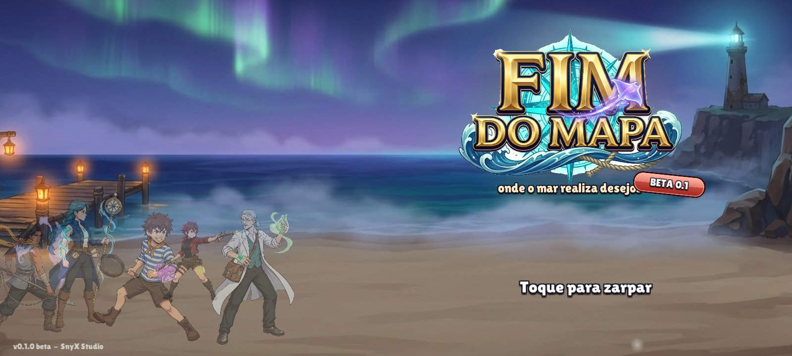
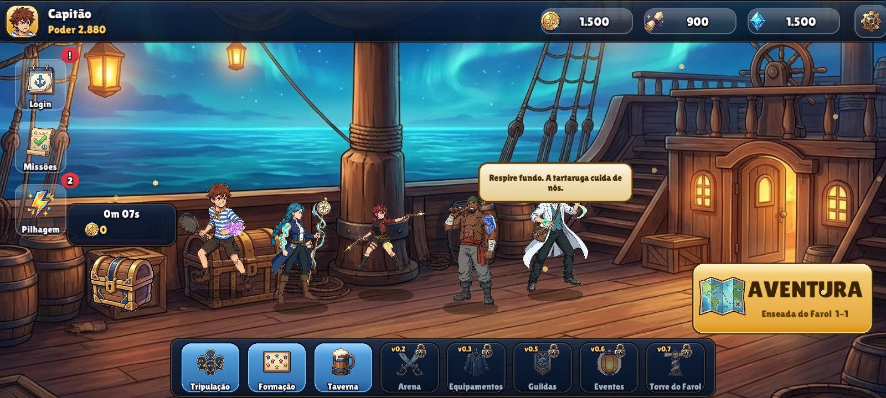
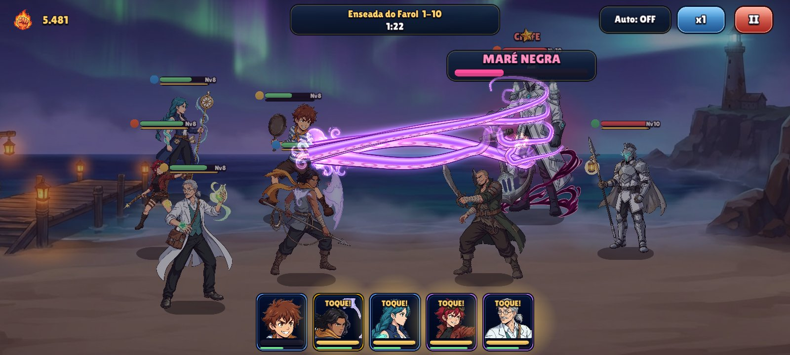
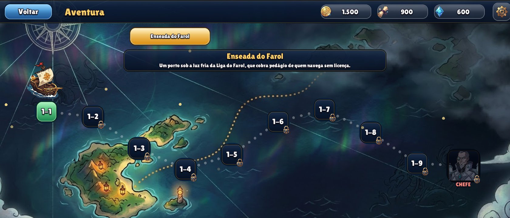

# Fim do Mapa

**RPG de aventura pirata para Android — versão 0.1 beta.**
Monte sua tripulação, navegue pela Enseada do Farol e enfrente a Liga do Farol. Cada herói carrega uma *Marca de Maré*:
uma criatura do mar que salta da pele no golpe especial. O chefe da ilha prepara a **Maré Negra**, e só quem
atordoa na hora certa consegue interrompê-la.

<p align="center">
  
  
</p>
<p align="center">
  
  
</p>

## Baixar e instalar no celular

1. No celular, abra a página **Releases** deste repositório e baixe o arquivo `FimDoMapa.apk` da versão mais nova.
2. Toque no arquivo baixado. Se o Android pedir, permita **instalar apps desta fonte** (o navegador ou o gerenciador
   de arquivos) — o jogo não vem da Play Store.
3. Abra **Fim do Mapa**. O jogo roda deitado (paisagem) e salva o progresso no próprio aparelho.

**Requisitos:** Android 8.0 ou mais novo, processador de 64 bits (ARM64) — praticamente todo celular de 2019 em diante.
A tela se ajusta a qualquer formato, de tablet 4:3 a celular 21:9, e os botões ficam fora do notch.

## O que tem na beta 0.1

- **Navio (hub):** tripulação no convés, baú que junta ouro e XP enquanto você está fora, missões diárias e login de 7 dias.
- **Aventura:** a Enseada do Farol com 10 fases e o chefe Barba-Sal na fase 10.
- **Batalha automática com decisão:** fúria enche nos ataques; toque na carta do herói para soltar o especial
  (ou deixe no Auto). Durante a Maré Negra, a carta de quem atordoa vira o alerta **ATORDOE!**.
- **6 heróis com Marcas:** Pipo (polvo), Marina (moreia), Lina (peixe-leão), Bento (tubarão), Dr. Mirto (tartaruga)
  e Kalu (raia).
- **Pipo com física completa:** esqueleto 2D com molas (cabelo, lenço e frigideira reagem ao movimento) e o
  *Abraço do Polvo* com tentáculos de física de corda que agarram, erguem e batem o inimigo no chão.
- **Taverna:** recrutamento com garantia de SSR visível, formação 2 + 3 com sinergia de elemento, evolução de nível e estrelas.

## Para desenvolvedores

| Item | Versão / local |
|---|---|
| Motor | Unity **6000.6.8f1** (Unity 6.6) |
| Linguagens | C# (casca do motor, IL2CPP) + **Lua 5.4** via xLua (todo o jogo e a interface) |
| Código Lua | `client/lua/` (telas) e `shared/lua/` (motor de batalha e dados) |
| Dados de design | `excel/*.xlsx` → `shared/lua/Data/` com `tools/excel2lua.py` |
| Arte | `Assets/Resources/Sprites/`; esqueleto do Pipo em `Assets/Resources/Rigs/heroi_pipo.json` |

### Compilar

Abra o **Unity Hub** (ele precisa estar aberto para a licença) e rode na raiz do projeto:

```bash
"C:/Program Files/Unity/Hub/Editor/6000.6.8f1/Editor/Unity.exe" -batchmode -projectPath . -buildTarget Android -executeMethod BuildTool.BuildApk -logFile build.log
```

O APK sai em `Builds/FimDoMapa.apk`. Para a versão de teste no Windows, troque por
`-buildTarget StandaloneWindows64 -executeMethod BuildTool.BuildWindows` (sai em `Builds/Windows/`).
O build empacota o Lua sozinho. O Android usa as ferramentas em `%USERPROFILE%\AndroidRE` (JDK 17, SDK e NDK)
ou na pasta indicada pela variável de ambiente `MARE_ANDROID_TOOLS`.

### Testes

```bash
python tools/testes/testar_cliente.py
```

Roda todas as telas sem o Unity, com o UIKit simulado, em 16:9, 20:9, 4:3 e 20:9 com notch.
`tools/testes/testar_batalha.py` confere o motor de batalha (determinístico) e
`tools/testes/testar_mare_negra.py` confere a mecânica do chefe. Precisam do pacote Python `lupa`.

No build de Windows, `-autotest <pasta>` percorre o jogo e salva capturas de cada tela, e `-vitrine <pasta>`
filma o Pipo em câmera lenta. `-notch <px>` simula um entalhe de câmera.

## Créditos e licença

© 2026 SnyX Studio. **Todos os direitos reservados** — o código e a arte deste repositório não têm licença aberta.

- Personagens, nomes e mundo são originais. Ilustrações geradas com IA (Google Gemini) e recortadas para o jogo.
- [xLua](https://github.com/Tencent/xLua) (Tencent), licença MIT.
- Fonte **Lilita One** (Juan Montoreano), SIL Open Font License 1.1 — texto em `Assets/Resources/Fonts/OFL-LilitaOne.txt`.
